# OrderFlow – Sistema Modular de Pedidos y Promociones

## 1. Descripción del proyecto

OrderFlow es un sistema desarrollado para gestionar pedidos y aplicar promociones mediante una arquitectura modular basada en OSGi.

El objetivo principal de este proyecto es construir una aplicación en la que sus funcionalidades estén separadas en módulos independientes, permitiendo que cada uno tenga una responsabilidad específica y pueda comunicarse con los demás mediante servicios.

Para desarrollar el proyecto utilicé Java 17, Maven y Apache Karaf como entorno de ejecución OSGi. Posteriormente, incorporé una API REST para permitir la comunicación entre el backend desarrollado en Java y una interfaz gráfica construida con React.

Con este proyecto busco demostrar cómo una aplicación puede organizarse mediante módulos independientes, cómo se comunican entre sí y cómo se pueden controlar sus servicios durante la ejecución.

## 2. Objetivos

- Implementar una arquitectura modular utilizando OSGi.
- Separar las funcionalidades de pedidos y promociones en diferentes bundles.
- Utilizar servicios OSGi para comunicar los módulos.
- Implementar una API REST para exponer las funcionalidades del backend.
- Conectar una interfaz desarrollada en React con los servicios Java.
- Registrar, consultar y actualizar pedidos.
- Aplicar promociones mediante un motor de reglas.
- Consultar el estado de los bundles y componentes OSGi.
- Comprobar el funcionamiento del sistema mediante pruebas.

## 3. Tecnologías utilizadas

| Tecnología | Uso |
|---|---|
| Java 17 | Desarrollo del backend |
| Maven 3.10.0 | Administración y compilación del proyecto |
| Apache Karaf 4.4.12 | Ejecución y administración de OSGi |
| OSGi Declarative Services | Registro e interacción entre servicios |
| Apache Felix SCR | Administración de componentes OSGi |
| React 19 | Desarrollo de la interfaz gráfica |
| TypeScript | Desarrollo del frontend |
| Vite | Ejecución y compilación de React |
| HTTP / JSON | Comunicación entre frontend y backend |
| Git y GitHub | Control de versiones y almacenamiento del proyecto |

## 4. Arquitectura del sistema

Para desarrollar OrderFlow elegí una arquitectura modular basada en OSGi.

Elegí este enfoque porque necesitaba separar las responsabilidades del sistema y permitir que los diferentes módulos se comuniquen mediante servicios, sin tener que concentrar toda la lógica en una sola aplicación.

La arquitectura está organizada en los siguientes componentes:

### 4.1 Order Service

Es el módulo encargado de administrar los pedidos.

Sus principales responsabilidades son:

- Crear pedidos.
- Consultar los pedidos registrados.
- Actualizar el estado de los pedidos.
- Proporcionar el servicio `OrderService` para que otros módulos puedan utilizar sus funcionalidades.

Para esta implementación utilicé un almacenamiento en memoria, mediante la clase `InMemoryOrderService`.

### 4.2 Promotion Engine

Es el módulo encargado de calcular y aplicar promociones a los pedidos.

Sus responsabilidades son:

- Recibir la información de un pedido.
- Evaluar las condiciones de las promociones.
- Calcular el descuento correspondiente.
- Devolver el resultado de la promoción.

Implementé una regla de descuento del 10 % para pedidos de 100 dólares o más.

Este módulo utiliza el servicio `OrderService` mediante una referencia OSGi dinámica y opcional. De esta manera, puede detectar la disponibilidad del servicio de pedidos durante la ejecución.

### 4.3 REST API

Este módulo permite que las funcionalidades desarrolladas en Java puedan utilizarse desde otras aplicaciones mediante peticiones HTTP.

Implementé tres componentes principales:

- `SystemServlet`: permite consultar información del entorno OSGi y su disponibilidad.
- `OrdersServlet`: permite trabajar con los pedidos mediante la API REST.
- `PromotionsServlet`: permite acceder a las funcionalidades del motor de promociones.

Para publicar estos componentes utilicé el soporte HTTP de Apache Karaf.

### 4.4 Frontend React

Desarrollé una interfaz gráfica utilizando React para que el usuario pueda interactuar con el sistema.

La finalidad del frontend es facilitar las operaciones de pedidos, promociones y monitoreo, evitando que todas las acciones tengan que ejecutarse manualmente desde la consola de Karaf.

La comunicación con Java se realiza mediante peticiones HTTP a la API REST.

## 5. Funcionamiento general

El funcionamiento del sistema se organiza de la siguiente manera:

1. El usuario interactúa con la interfaz de React.
2. React envía una petición HTTP a la API REST.
3. La API recibe la solicitud y utiliza el servicio OSGi correspondiente.
4. Order Service procesa y administra la información del pedido.
5. Promotion Engine evalúa las condiciones de las promociones cuando se solicita.
6. La API devuelve una respuesta en formato JSON.
7. React recibe la respuesta y muestra los resultados al usuario.

De esta manera, cada módulo mantiene sus responsabilidades separadas y la comunicación se realiza mediante servicios e interfaces definidas.

## 6. Estructura del proyecto

La estructura principal del repositorio está organizada de la siguiente manera:

```text
order-flow/
│
├── order-service/
│   └── src/
│       └── main/java/
│           └── ec/udla/orderflow/orders/
│               ├── api/
│               └── internal/
│
├── promotion-engine/
│   └── src/
│       └── main/java/
│           └── ec/udla/orderflow/promotions/
│               ├── api/
│               ├── internal/
│               └── rules/
│
├── rest-api/
│   └── src/
│       └── main/java/
│           └── ec/udla/orderflow/rest/
│               └── internal/
│
├── frontend/
│   ├── src/
│   │   ├── components/
│   │   ├── pages/
│   │   ├── services/
│   │   └── App.tsx
│   ├── package.json
│   └── vite.config.ts
│
├── scripts/
│   └── test-rest-api.ps1
│
├── docs/
│   ├── arquitectura/
│   ├── evidencias/
│   └── investigacion/
│
├── pom.xml
├── README.md
└── .gitignore
```

## 7. Instalación y ejecución

### 7.1 Requisitos previos

Antes de ejecutar el proyecto es necesario tener instalado:

- JDK 17.
- Apache Maven.
- Apache Karaf 4.4.12.
- Node.js y npm.
- Visual Studio Code (recomendado).

Para comprobar Java y Maven ejecuté:

```powershell
java -version
javac -version
mvn -version
```

### 7.2 Compilar el backend

Primero es necesario ubicarse en la carpeta raíz del proyecto:

```powershell
cd C:\AME\JAVA\order-flow
```

Para compilar los módulos y generar los bundles ejecuté:

```powershell
mvn clean install
```

También se puede compilar específicamente la API REST junto con sus dependencias:

```powershell
mvn -pl rest-api -am clean install
```

Al finalizar, Maven genera los archivos JAR dentro de las carpetas `target` de cada módulo.

### 7.3 Ejecutar Apache Karaf

Una vez compilados e instalados los módulos en el repositorio local de Maven, inicié Apache Karaf.

Desde su consola habilité el soporte HTTP:

```text
feature:install http-whiteboard
```

Después instalé los tres bundles:

```text
bundle:install -s mvn:ec.udla.orderflow/order-service/1.0.0
```

```text
bundle:install -s mvn:ec.udla.orderflow/promotion-engine/1.0.0
```

```text
bundle:install -s mvn:ec.udla.orderflow/orderflow-rest-api/1.0.0
```

Para comprobar que se encuentran funcionando utilicé:

```text
bundle:list
```

También utilicé:

```text
scr:list
```

Estos comandos permiten consultar los bundles instalados y los componentes administrados por Declarative Services.

### 7.4 Ejecutar el frontend

Para iniciar React abrí una terminal en la carpeta `frontend`:

```powershell
cd C:\AME\JAVA\order-flow\frontend
```

Instalé las dependencias:

```powershell
npm.cmd install
```

Después ejecuté:

```powershell
npm.cmd run dev
```

Vite proporciona una dirección local para abrir la aplicación en el navegador, normalmente:

```text
http://localhost:5173
```

## 8. API REST y pruebas de funcionamiento

Para comprobar que el backend estuviera disponible realicé diferentes pruebas mediante PowerShell.

### 8.1 Comprobar disponibilidad del sistema

Ejecuté la siguiente petición:

```powershell
Invoke-RestMethod -Uri "http://localhost:8181/api/system/health"
```

El resultado obtenido fue:

```text
status      : UP
runtime     : Apache Karaf / OSGi
bundleCount : 84
```

Con esta prueba comprobé que la API REST respondía correctamente y que podía comunicarse con el entorno Apache Karaf.

### 8.2 Prueba automatizada de la API

Para facilitar las comprobaciones desarrollé un script de PowerShell:

```text
scripts/test-rest-api.ps1
```

Lo ejecuté utilizando:

```powershell
powershell -ExecutionPolicy Bypass -File .\scripts\test-rest-api.ps1
```

El script realiza seis comprobaciones:

1. Comprueba que el entorno OSGi esté disponible.
2. Crea un pedido de prueba.
3. Consulta los pedidos registrados.
4. Evalúa una promoción.
5. Actualiza el estado de un pedido.
6. Consulta los estados de los bundles OSGi.

### 8.3 Resultado de la promoción

Durante las pruebas registré un pedido de 150 dólares.

El motor de promociones aplicó correctamente el descuento del 10 %.

| Concepto | Valor |
|---|---:|
| Total original | $150.00 |
| Descuento aplicado | $15.00 |
| Total después del descuento | $135.00 |
| Código de promoción | TEN_PERCENT_OVER_100 |

También comprobé que el pedido cambiara de estado de `CREATED` a `PROCESSING`.

Estas pruebas permitieron comprobar que el servicio de pedidos y el motor de promociones trabajan correctamente.

## 9. Monitoreo y comprobación de servicios OSGi

Una parte importante del proyecto fue comprobar qué sucede cuando los servicios están disponibles y qué ocurre cuando alguno deja de funcionar.

Para ello utilicé los comandos de administración de Apache Karaf.

### Consultar bundles

```text
bundle:list
```

### Consultar componentes

```text
scr:list
```

### Consultar información de un componente

```text
scr:info ec.udla.orderflow.promotions.internal.PromotionEngineComponent
```

### Detener un bundle

```text
bundle:stop ID
```

### Iniciar nuevamente un bundle

```text
bundle:start ID
```

Realicé pruebas deteniendo Order Service y observando cómo Promotion Engine detectaba la ausencia de su servicio asociado.

Cuando inicié nuevamente Order Service, Promotion Engine volvió a establecer la referencia al servicio.

Con esto comprobé una de las ventajas de OSGi: los módulos pueden administrar sus dependencias durante la ejecución, sin necesidad de detener todo el sistema.

## 10. Almacenamiento de información

En esta versión utilicé almacenamiento en memoria para administrar los pedidos.

Esto permite realizar las pruebas de creación, consulta y actualización sin necesidad de configurar una base de datos externa.

Sin embargo, es importante considerar que la información almacenada no es permanente. Si se reinicia el servicio o el entorno, los pedidos almacenados pueden perderse.

## 11. Evidencias del proyecto

En esta sección presento las capturas que fui obteniendo durante el desarrollo y las pruebas de OrderFlow.

Las evidencias permiten comprobar tanto la configuración inicial como el funcionamiento de los módulos, la API REST y la integración con el frontend.

Las imágenes están almacenadas en la carpeta `docs/evidencias/`.

### 11.1 Configuración y funcionamiento de OSGi

En las primeras capturas se muestra la preparación del entorno, la configuración de Maven, la compilación de los módulos, la instalación de los bundles y las pruebas de disponibilidad de los servicios.

**Servicios OSGi registrados**

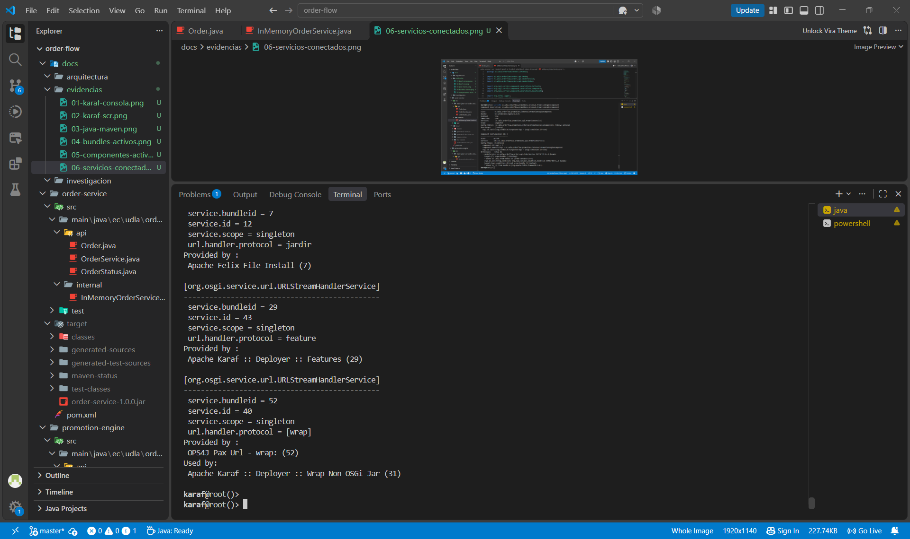

**Compilación del proyecto Maven**

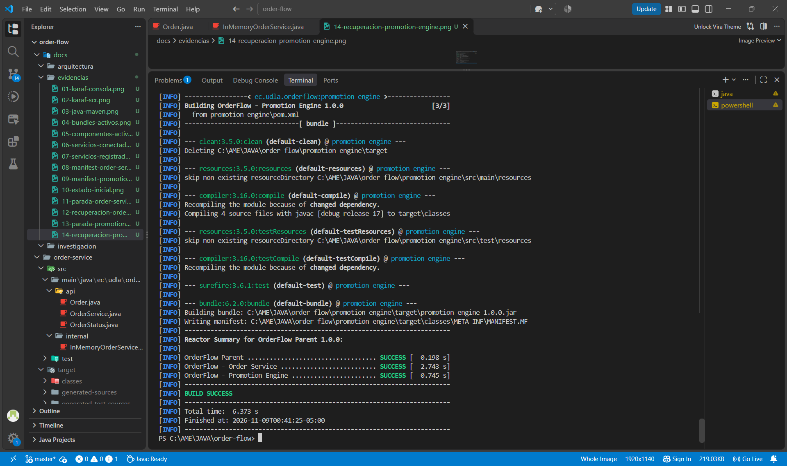

### 11.2 Pruebas de la API REST

**Disponibilidad del entorno**

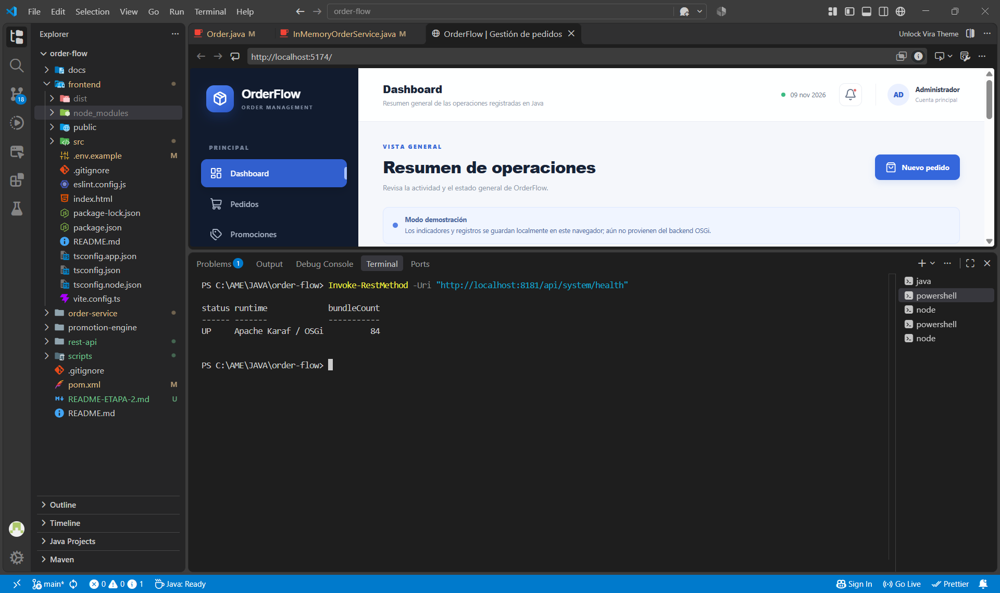

**Pruebas completas de la API REST**

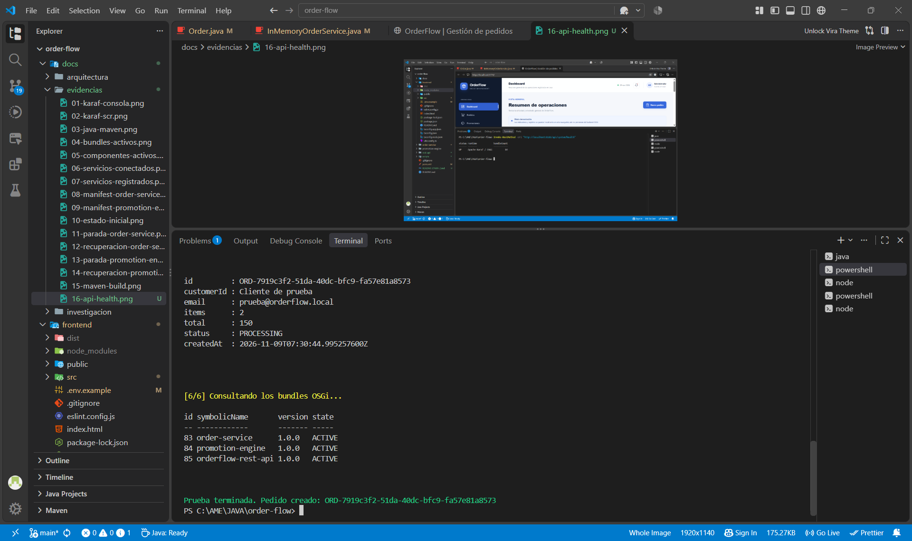

### 11.3 Interfaz gráfica e integración con React

**Panel principal**

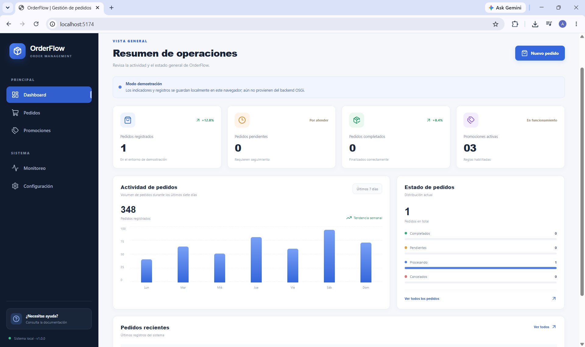

**Registro de pedidos**

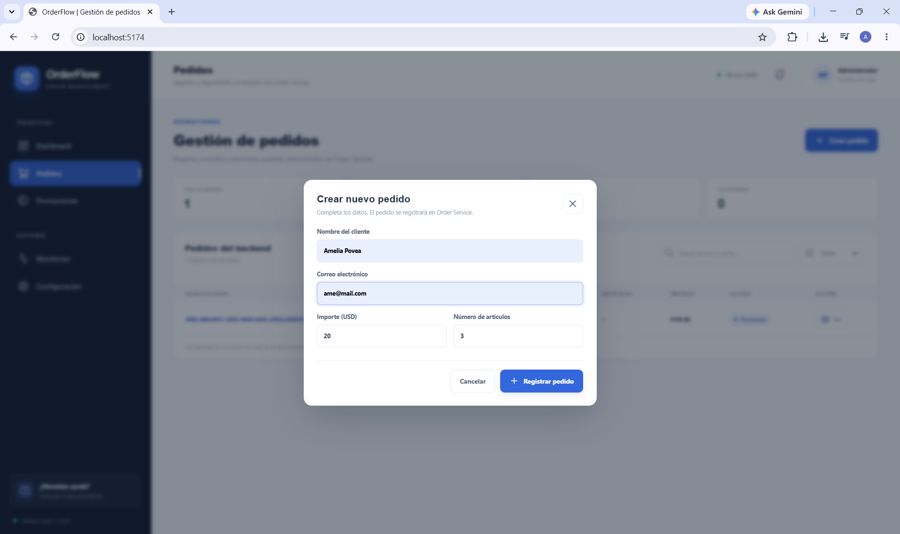

**Comunicación entre React y Java**

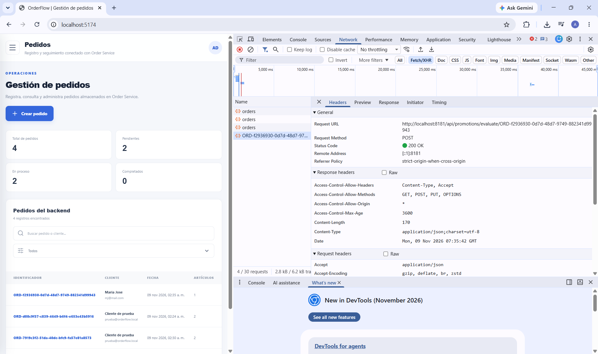

**Consulta de pedidos**

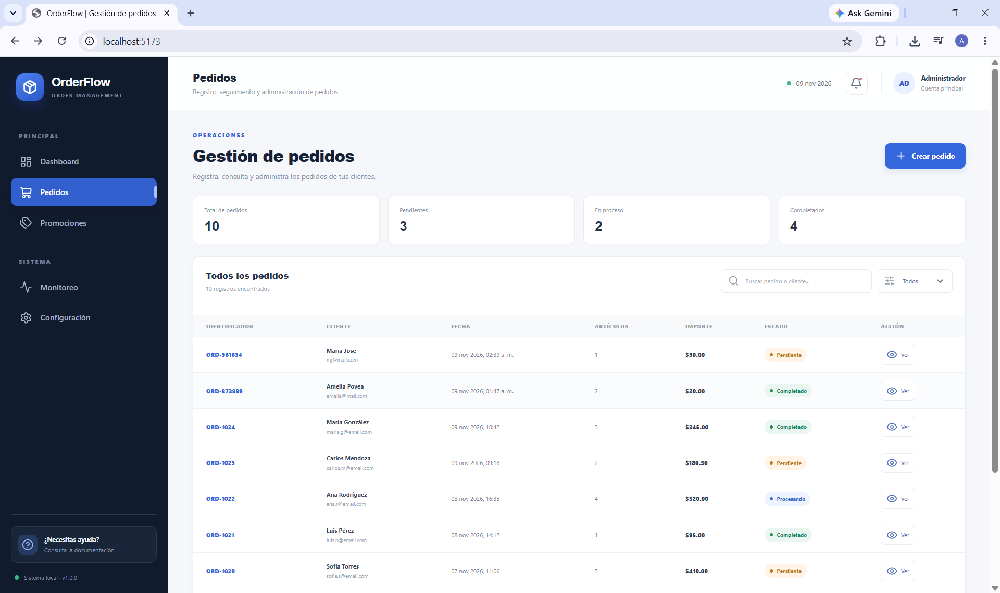

**Motor de promociones**

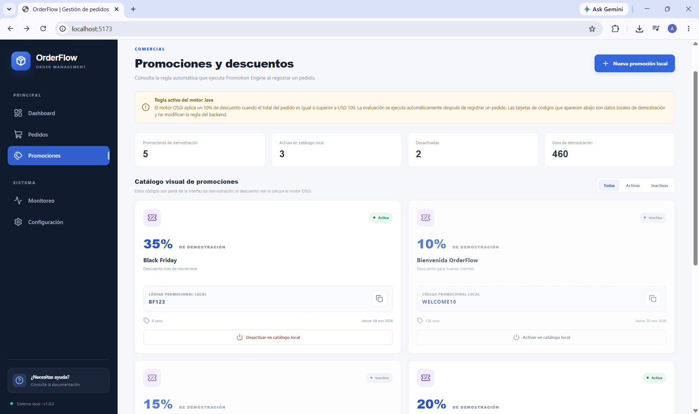

**Actualización del estado del pedido**

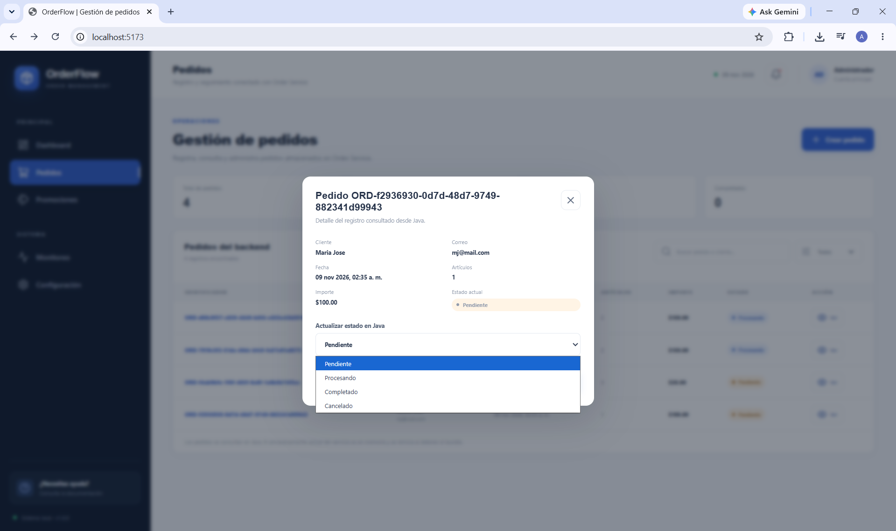

**Monitoreo de bundles OSGi**

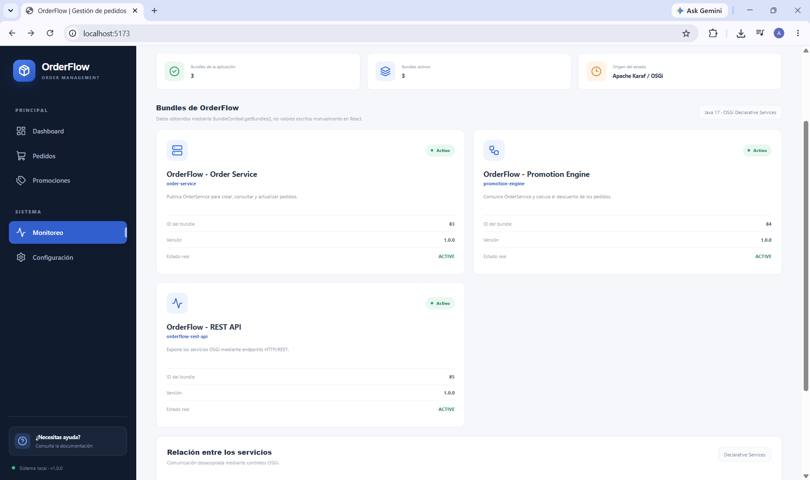

## 12. Conclusiones

Durante el desarrollo de OrderFlow pude comprender y aplicar el funcionamiento de una arquitectura modular utilizando OSGi.

Separar el sistema en diferentes bundles permitió que cada módulo tuviera una responsabilidad específica. Order Service se encarga de los pedidos, Promotion Engine administra las reglas de descuentos y REST API permite acceder a estas funcionalidades mediante HTTP.

También comprobé la utilidad de Declarative Services para administrar las dependencias entre módulos durante la ejecución. Las pruebas de detener y volver a iniciar los bundles permitieron observar cómo responde el sistema cuando un servicio deja de estar disponible.

La incorporación de React permitió avanzar hacia una aplicación con una interfaz gráfica que utiliza los servicios desarrollados en Java.

Finalmente, considero que este proyecto me permitió comprender mejor la importancia de la modularidad, la separación de responsabilidades, la comunicación entre servicios y el monitoreo de una aplicación durante su ejecución.

## 13. Repositorio

El código fuente y los archivos del proyecto se encuentran disponibles en GitHub:

[OrderFlow – Repositorio GitHub](https://github.com/amelipovea/order-flow)