# OrderFlow — Sistema modular de pedidos y promociones con OSGi

## 1. Introducción

Para este proyecto desarrollamos **OrderFlow**, un sistema de gestión de pedidos y aplicación de promociones, utilizando una arquitectura modular basada en OSGi y Apache Karaf como entorno de ejecución.

El propósito principal fue comprender cómo funciona OSGi y cómo podemos utilizarlo para construir aplicaciones cuyos componentes puedan instalarse, iniciarse, detenerse y actualizarse de manera independiente, sin necesidad de apagar todo el sistema.

Decidimos trabajar con un ejemplo de pedidos y promociones porque nos permite representar un escenario de negocio sencillo, pero que también se puede encontrar en aplicaciones reales. Por un lado, tenemos un módulo encargado de administrar los pedidos y, por otro, un módulo que se encarga de gestionar las promociones.

Aunque ambos módulos están relacionados, buscamos evitar que dependan directamente de las clases internas del otro. Para conseguirlo utilizamos interfaces y el registro de servicios de OSGi.

De esta manera, no solamente implementamos dos módulos que compilan por separado, sino que comprobamos cómo se comunican dentro de un mismo entorno y cómo se comportan cuando uno de ellos deja de estar disponible.

## 2. Objetivos del proyecto

### Objetivo general

Implementar un sistema modular utilizando Apache Karaf y OSGi, compuesto por dos bundles funcionales relacionados entre sí, con bajo acoplamiento y capacidad de iniciar y detener cada componente independientemente.

### Objetivos específicos

- Investigar el funcionamiento de OSGi, sus características y los patrones arquitectónicos relacionados.
- Configurar Apache Karaf como entorno de ejecución de los bundles.
- Desarrollar un bundle encargado de administrar los pedidos y publicar un servicio.
- Desarrollar un segundo bundle encargado de gestionar las promociones y consumir el servicio publicado por el primero.
- Utilizar el registro de servicios de OSGi para comunicar ambos módulos.
- Comprobar que los bundles puedan detenerse e iniciarse sin apagar Apache Karaf ni detener innecesariamente el otro módulo.
- Documentar las pruebas realizadas mediante capturas de la consola y del entorno de ejecución.

---

## 3. Investigación: ¿Qué es OSGi?

OSGi (Open Services Gateway initiative) es una plataforma para desarrollar y ejecutar aplicaciones Java de manera modular.

Su principal característica es que permite dividir una aplicación en componentes independientes llamados **bundles**. Cada bundle contiene sus propias clases, recursos, dependencias y configuración, además de definir qué paquetes necesita y cuáles pone a disposición de otros componentes.

A diferencia de una aplicación Java tradicional, donde normalmente ejecutamos todo como una sola unidad, OSGi permite administrar los componentes individualmente durante la ejecución.

Entre sus principales características encontramos:

- **Modularidad:** permite dividir una aplicación en módulos independientes.
- **Bajo acoplamiento:** los componentes pueden comunicarse mediante interfaces y servicios, sin conocer necesariamente sus implementaciones internas.
- **Registro de servicios:** permite publicar servicios para que otros bundles puedan encontrarlos y utilizarlos.
- **Gestión del ciclo de vida:** permite instalar, iniciar, detener, actualizar y desinstalar bundles.
- **Gestión de dependencias:** controla los paquetes que necesita cada componente y verifica si están disponibles.
- **Servicios dinámicos:** permite detectar cuándo un servicio aparece, desaparece o vuelve a estar disponible.

### ¿Qué podemos hacer con OSGi?

OSGi puede utilizarse para construir aplicaciones que necesitan una estructura modular y flexible.

Por ejemplo, podemos tener un sistema empresarial dividido en módulos de usuarios, pedidos, facturación, inventario y reportes. Cada módulo puede ofrecer servicios a los demás sin que todos tengan que conocer su implementación interna.

También se utiliza en aplicaciones extensibles, plataformas empresariales, sistemas embebidos y entornos donde se necesita administrar componentes durante la ejecución.

### ¿A qué patrones de arquitectura responde?

OSGi no es un único patrón de arquitectura, sino una plataforma que permite implementar diferentes enfoques arquitectónicos.

En nuestra investigación identificamos principalmente los siguientes:

**Arquitectura modular basada en componentes**

Es el enfoque principal que utilizamos. La aplicación se divide en módulos independientes, cada uno con responsabilidades específicas y contratos de comunicación definidos.

**Arquitectura orientada a servicios (SOA)**

OSGi permite publicar servicios mediante interfaces y un registro centralizado. Otros componentes pueden descubrir esos servicios y utilizarlos sin depender directamente de las clases que los implementan.

**Arquitectura de microkernel o basada en plugins**

El entorno principal proporciona las funcionalidades necesarias para ejecutar la aplicación, mientras que los bundles agregan capacidades de manera modular. Apache Karaf permite administrar estos componentes dinámicamente.

Es importante aclarar que los bundles OSGi no son microservicios. En nuestra implementación ambos se ejecutan dentro del mismo entorno de ejecución Java, pero mantienen independencia a nivel modular y de ciclo de vida.

---

## 4. Tecnologías utilizadas

Para desarrollar el proyecto utilizamos las siguientes tecnologías:

| Tecnología | Versión | Función |
|---|---|---|
| Java JDK | 17 | Lenguaje y entorno de desarrollo |
| Apache Maven | 3.10.0 | Gestión de dependencias y construcción |
| Apache Karaf | 4.4.12 | Entorno de ejecución OSGi |
| OSGi Declarative Services | Compatible con Karaf 4.4.12 | Registro e inyección de servicios |
| Maven Bundle Plugin | 6.2.0 | Generación de bundles OSGi |
| Visual Studio Code | 1.144.1 | Entorno de desarrollo |
| Git | — | Control de versiones |

Elegimos Java 17 porque es la versión con la que configuramos la compilación del proyecto y Apache Karaf 4.4.12 porque nos proporciona un entorno preparado para administrar bundles OSGi.

Utilizamos Maven para mantener una estructura organizada y generar los archivos JAR con los metadatos necesarios para que Karaf pueda reconocerlos como bundles.

---

## 5. Arquitectura del sistema

Para OrderFlow diseñamos una arquitectura modular compuesta por dos bundles principales que se comunican mediante servicios OSGi.

### Diagrama de arquitectura

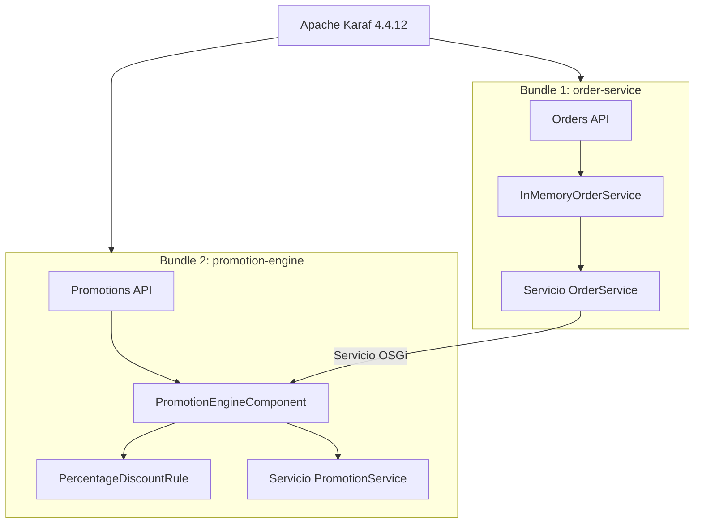

### 5.1. Bundle Order Service

Este es el módulo encargado de administrar la parte relacionada con los pedidos.

Su responsabilidad es proporcionar un servicio público que pueda ser utilizado por otros componentes del sistema.

Dentro de este módulo tenemos:

- **Order:** representa la información de un pedido.
- **OrderStatus:** representa los estados de un pedido.
- **OrderService:** define el contrato público del servicio.
- **InMemoryOrderService:** contiene la implementación del servicio.

La clase `InMemoryOrderService` implementa la interfaz `OrderService` y publica el servicio mediante OSGi.

Elegimos separar la interfaz de su implementación para que otros módulos no tengan que conocer cómo funciona internamente el servicio.

### 5.2. Bundle Promotion Engine

Este módulo se encarga de la gestión de las promociones.

Su responsabilidad es consumir el servicio de pedidos y proporcionar un servicio relacionado con la evaluación de promociones.

Dentro de este módulo tenemos:

- **PromotionService:** define el contrato público para las operaciones de promociones.
- **PromotionEngineComponent:** implementa el componente encargado de gestionar el motor de promociones y su conexión con Order Service.
- **PercentageDiscountRule:** contiene la regla de descuento porcentual.
- **PromotionResult:** representa el resultado relacionado con una promoción.

Una característica importante de este módulo es que también publica su propio servicio, llamado `PromotionService`.

De esta manera, Promotion Engine no solamente consume servicios de otro bundle, sino que también puede ofrecer funcionalidades a otros componentes.

### 5.3. Comunicación entre los bundles

Para comunicar los dos módulos utilizamos el mecanismo de servicios de OSGi.

Order Service publica la interfaz:

`ec.udla.orderflow.orders.api.OrderService`

Por su parte, Promotion Engine utiliza una referencia OSGi para encontrar y consumir ese servicio.

En nuestra implementación utilizamos `@Reference` con las siguientes características:

```java
@Reference(
    cardinality = ReferenceCardinality.OPTIONAL,
    policy = ReferencePolicy.DYNAMIC
)
```

Elegimos estas propiedades por dos razones:

- **OPTIONAL:** permite que Promotion Engine pueda mantenerse activo aunque Order Service no esté disponible temporalmente.
- **DYNAMIC:** permite que la referencia se desconecte cuando el servicio desaparece y vuelva a conectarse cuando esté disponible nuevamente.

También implementamos los métodos `bindOrderService()` y `unbindOrderService()` para gestionar la conexión y desconexión del servicio.

Esto permite que los componentes estén relacionados, pero sin mantener una dependencia directa con la implementación interna del otro módulo.

---

## 6. Estructura del proyecto

Organizamos el repositorio utilizando Maven multi-módulo para separar las responsabilidades y facilitar el mantenimiento.

```text
order-flow/
│
├── pom.xml
├── README.md
├── .gitignore
│
├── order-service/
│   ├── pom.xml
│   └── src/
│       ├── main/
│       │   └── java/
│       │       └── ec/udla/orderflow/orders/
│       │           ├── api/
│       │           │   ├── Order.java
│       │           │   ├── OrderService.java
│       │           │   └── OrderStatus.java
│       │           │
│       │           └── internal/
│       │               └── InMemoryOrderService.java
│       │
│       └── test/
│
├── promotion-engine/
│   ├── pom.xml
│   └── src/
│       ├── main/
│       │   └── java/
│       │       └── ec/udla/orderflow/promotions/
│       │           ├── api/
│       │           │   ├── PromotionResult.java
│       │           │   └── PromotionService.java
│       │           │
│       │           ├── internal/
│       │           │   └── PromotionEngineComponent.java
│       │           │
│       │           └── rules/
│       │               └── PercentageDiscountRule.java
│       │
│       └── test/
│
└── docs/
    ├── arquitectura/
    ├── investigacion/
    └── evidencias/
```

El archivo `pom.xml` principal administra los dos módulos y permite construir el proyecto desde una única ubicación.

Cada módulo tiene su propio `pom.xml`, donde definimos sus dependencias y configuración para generar un bundle OSGi.

---

## 7. ¿Cómo funciona el proyecto?

El funcionamiento general se basa en la separación de responsabilidades.

Primero, Order Service proporciona las operaciones relacionadas con los pedidos y publica su servicio dentro del entorno OSGi.

Después, Promotion Engine busca ese servicio mediante la referencia definida en su componente.

Cuando el servicio está disponible, OSGi establece la conexión y Promotion Engine puede utilizar el contrato público de pedidos.

Por otra parte, Promotion Engine proporciona su propio servicio para las funcionalidades relacionadas con promociones.

La comunicación se realiza mediante interfaces públicas y el registro de servicios, evitando que los módulos tengan que acceder directamente a las clases internas de los demás.

Una decisión importante fue utilizar una implementación en memoria para los pedidos. Esto nos permitió concentrarnos en el objetivo principal del deber: comprender la modularidad, el registro de servicios y la gestión del ciclo de vida de los bundles.

Por esta razón, el proyecto no incorpora una base de datos ni persistencia permanente. La información almacenada en memoria no se conserva después de reiniciar la aplicación.

---

## 8. Instalación y ejecución

### Requisitos previos

Antes de ejecutar el proyecto necesitamos tener instalados:

- Java JDK 17.
- Apache Maven 3.10.0.
- Apache Karaf 4.4.12.

Podemos comprobar las versiones desde PowerShell:

```powershell
java -version
javac -version
mvn -version
```

Es importante comprobar que Maven también esté utilizando Java 17.

### 8.1. Construir el proyecto

Nos ubicamos en la carpeta principal del repositorio:

```powershell
cd C:\AME\JAVA\order-flow
```

Ejecutamos:

```powershell
mvn clean verify
```

Este comando limpia los archivos generados anteriormente, compila los módulos y ejecuta las fases de verificación configuradas en Maven.

Para instalar los artefactos en el repositorio local de Maven, utilizamos:

```powershell
mvn clean install
```

Esto nos permite utilizar posteriormente las coordenadas Maven para instalar los bundles en Karaf.

### 8.2. Iniciar Apache Karaf

Nos dirigimos a la carpeta de instalación de Karaf:

```powershell
cd C:\AME\JAVA\tools\karaf\apache-karaf-4.4.12\bin
```

Iniciamos el entorno:

```powershell
.\karaf.bat
```

Cuando Karaf inicia correctamente, aparece su consola:

```text
karaf@root()>
```

### 8.3. Habilitar Declarative Services

Desde la consola de Karaf ejecutamos:

```text
feature:install scr
```

Esto habilita el soporte de Declarative Services, que necesitamos para gestionar los componentes y referencias OSGi.

### 8.4. Instalar los bundles

Instalamos primero Order Service:

```text
bundle:install -s mvn:ec.udla.orderflow/order-service/1.0.0
```

Después instalamos Promotion Engine:

```text
bundle:install -s mvn:ec.udla.orderflow/promotion-engine/1.0.0
```

Utilizamos el parámetro `-s` para que los bundles se inicien después de su instalación.

Instalamos primero Order Service porque Promotion Engine necesita importar el paquete público de pedidos.

### 8.5. Comprobar el funcionamiento

Para consultar los bundles instalados ejecutamos:

```text
bundle:list
```

Para consultar los componentes OSGi:

```text
scr:list
```

Para comprobar la conexión de Promotion Engine:

```text
scr:info ec.udla.orderflow.promotions.internal.PromotionEngineComponent
```

Y para consultar los servicios registrados:

```text
service:list
```

Con estos comandos podemos verificar el estado de los módulos, los componentes y las referencias entre ellos.

**Nota:** los identificadores numéricos de los bundles pueden cambiar dependiendo de las instalaciones realizadas en Karaf. Por eso debemos consultar `bundle:list` antes de utilizar los comandos de inicio y parada.

---

## 9. Pruebas de funcionamiento y ciclo de vida

Una de las condiciones principales del deber consiste en demostrar que podemos detener un bundle sin afectar la ejecución del resto del sistema.

Para comprobarlo realizamos pruebas directamente desde la consola de Apache Karaf.

### 9.1. Estado inicial

Primero verificamos que los dos bundles estén activos:

```text
bundle:list
```

Comprobamos que aparezcan:

- OrderFlow - Order Service: ACTIVE.
- OrderFlow - Promotion Engine: ACTIVE.

También consultamos:

```text
scr:list
```

En este resultado comprobamos que los componentes `InMemoryOrderService` y `PromotionEngineComponent` se encuentran activos.

### 9.2. Comprobar la conexión entre servicios

Ejecutamos:

```text
scr:info ec.udla.orderflow.promotions.internal.PromotionEngineComponent
```

En la información obtenida comprobamos que la referencia `orderService` se encuentra satisfecha y vinculada al servicio publicado por Order Service.

El resultado muestra un binding hacia el bundle `order-service`.

Esto demuestra que Promotion Engine está consumiendo correctamente el servicio público del primer módulo.

### 9.3. Detener Order Service

Para comprobar el comportamiento cuando el proveedor deja de estar disponible ejecutamos:

```text
bundle:stop 57
```

Después consultamos:

```text
bundle:list
```

En nuestra prueba observamos que Order Service pasó a estado `Resolved`, mientras que Promotion Engine continuó en estado `Active`.

Posteriormente ejecutamos:

```text
scr:info ec.udla.orderflow.promotions.internal.PromotionEngineComponent
```

El resultado mostró:

```text
orderService:
SATISFIED 0..1 dynamic

(no active bindings)
```

Esto significa que la referencia al servicio de pedidos dejó de tener una conexión activa, pero Promotion Engine permaneció ejecutándose.

### 9.4. Recuperar Order Service

Volvimos a iniciar el bundle:

```text
bundle:start 57
```

Después consultamos nuevamente el componente:

```text
scr:info ec.udla.orderflow.promotions.internal.PromotionEngineComponent
```

En el resultado comprobamos que la referencia volvió a establecerse y apareció nuevamente un binding hacia Order Service.

En nuestra ejecución, el servicio se registró nuevamente con el identificador 102.

Esto demuestra que OSGi detectó la disponibilidad del servicio y recuperó la conexión dinámica sin necesidad de reiniciar Promotion Engine.

### 9.5. Detener Promotion Engine

También comprobamos el ciclo de vida del segundo módulo:

```text
bundle:stop 58
```

Después ejecutamos:

```text
bundle:list
```

En esta prueba verificamos que Promotion Engine pudiera detenerse mientras Order Service permanecía activo.

También utilizamos:

```text
service:list
```

para comprobar el estado de los servicios publicados.

### 9.6. Recuperar Promotion Engine

Finalmente volvimos a iniciar el segundo bundle:

```text
bundle:start 58
```

Consultamos nuevamente:

```text
bundle:list
scr:list
service:list
```

Con estas comprobaciones verificamos la recuperación del componente y la disponibilidad de los servicios.

### Resumen de las pruebas

| Prueba | Resultado esperado |
|---|---|
| Iniciar ambos bundles | Los dos quedan activos |
| Consultar servicios | Los servicios están registrados |
| Consultar Promotion Engine | La referencia a Order Service está vinculada |
| Detener Order Service | Promotion Engine continúa activo |
| Recuperar Order Service | La referencia vuelve a conectarse |
| Detener Promotion Engine | Order Service continúa activo |
| Recuperar Promotion Engine | El componente vuelve a estar disponible |

---

## 10. Evidencias del proyecto

Para demostrar el funcionamiento de nuestra implementación organizamos las capturas realizadas durante el desarrollo y las pruebas en la carpeta `docs/evidencias/`.

### 10.1. Configuración e instalación de Karaf

**01. Consola de Apache Karaf**

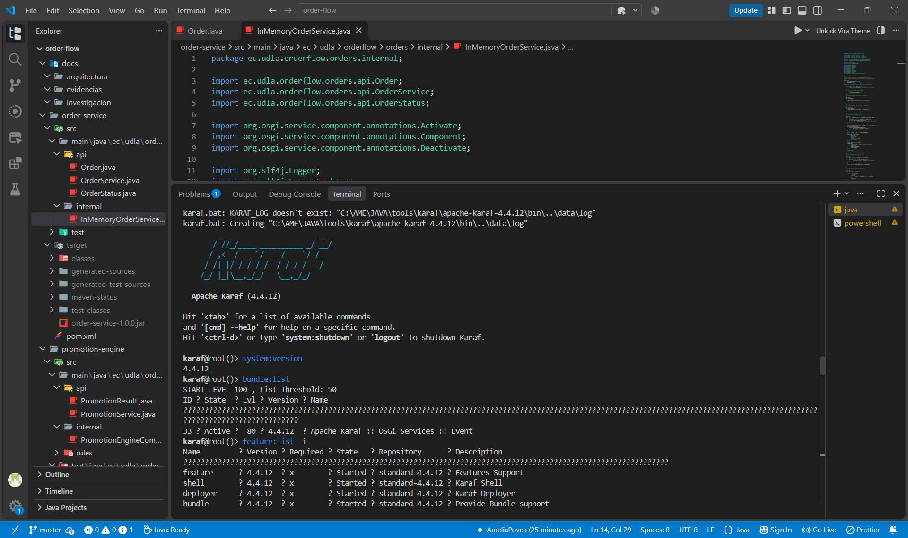

**02. Características instaladas y soporte SCR**

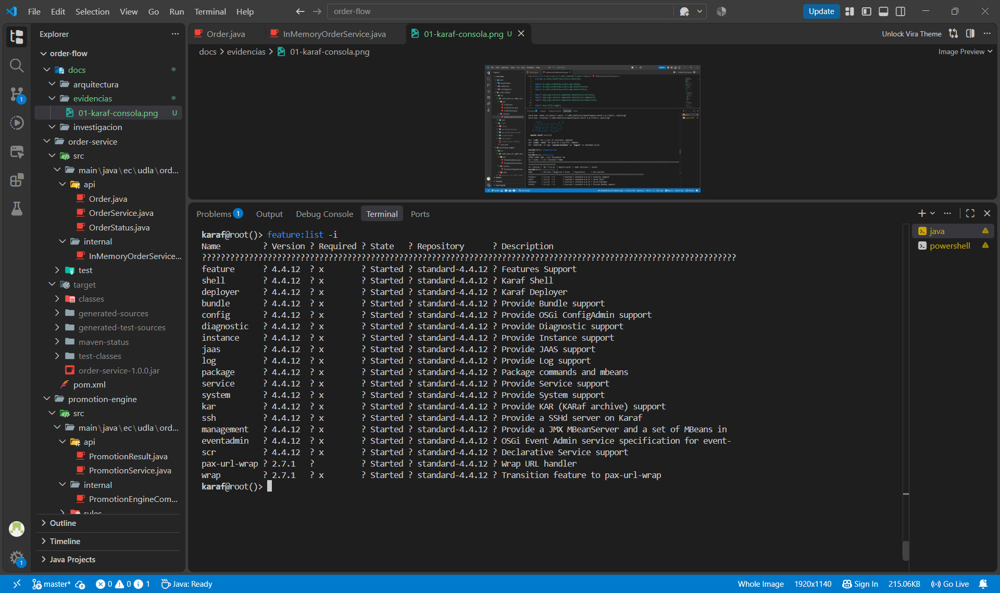

**03. Versiones de Java y Maven**

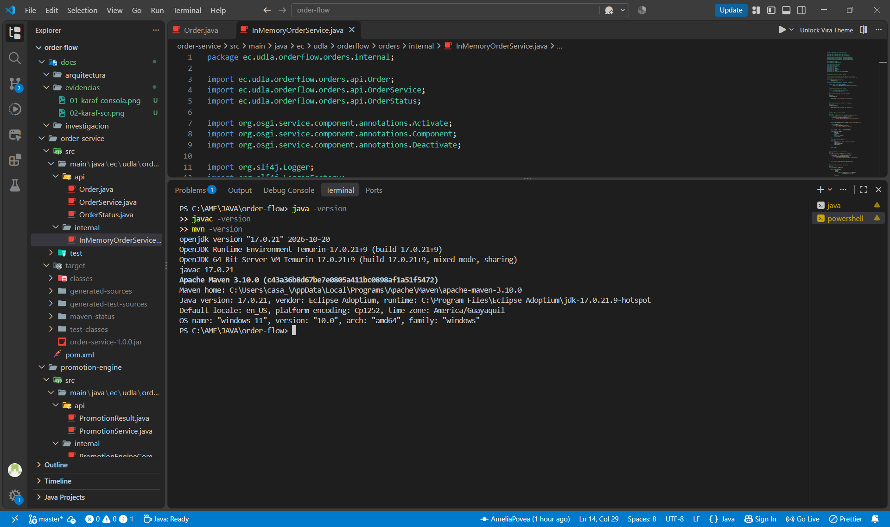

### 10.2. Bundles y servicios OSGi

**04. Bundles activos**

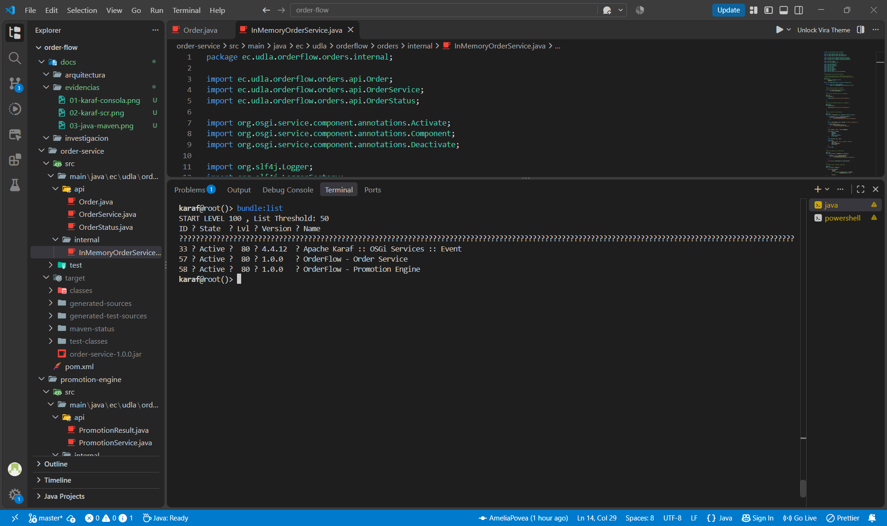

**05. Componentes OSGi activos**

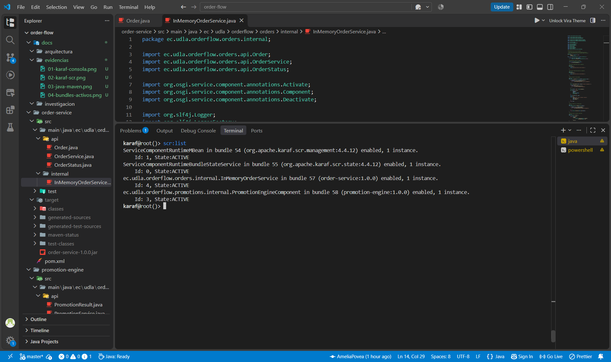

**06. Referencia entre Order Service y Promotion Engine**

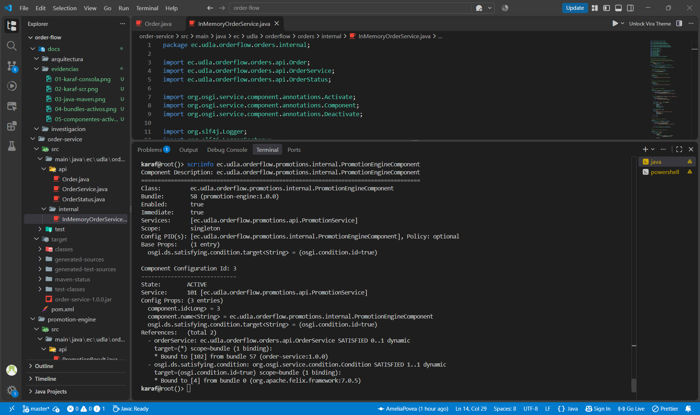

**07. Servicios registrados en OSGi**


### 10.3. Inspección de los bundles

**08. Manifiesto de Order Service**

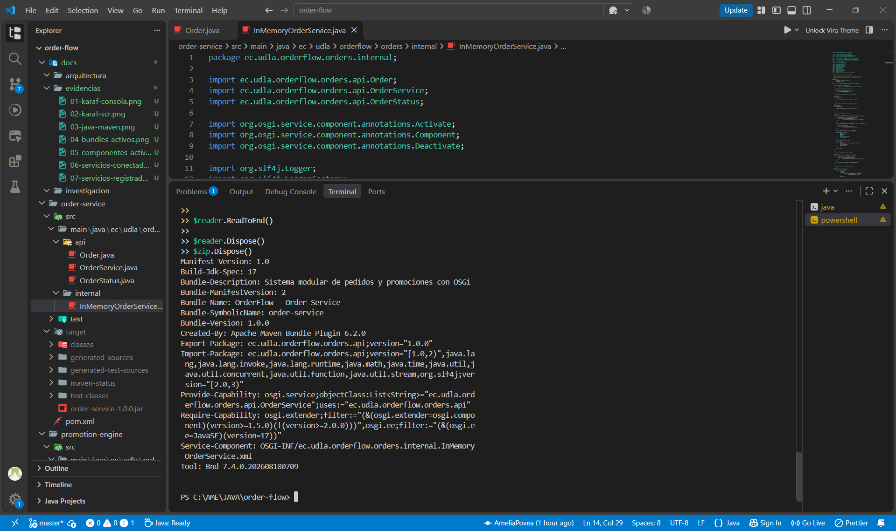

**09. Manifiesto de Promotion Engine**

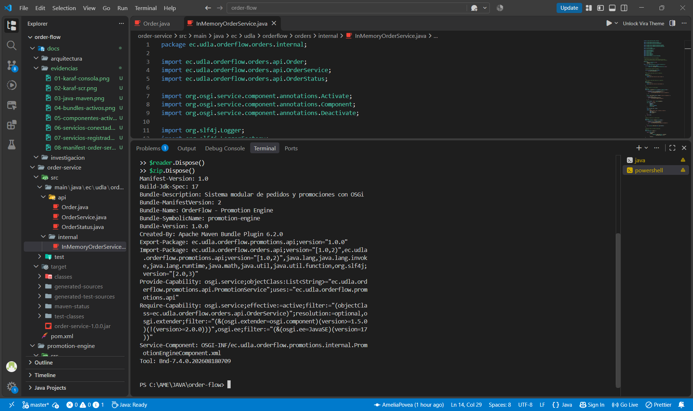

### 10.4. Pruebas de inicio y parada

**10. Estado inicial de los dos bundles**

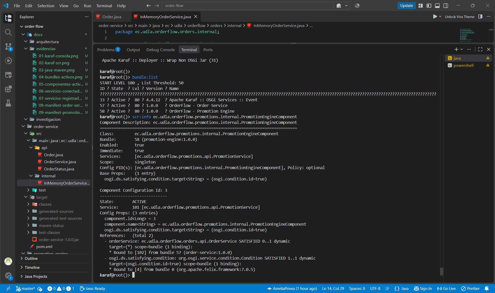

**11. Detención de Order Service**

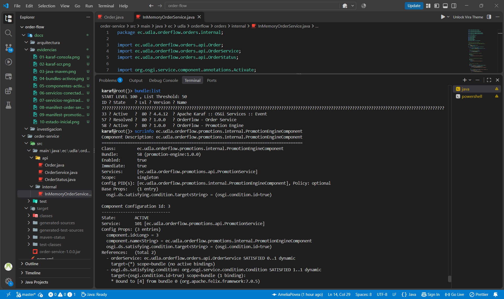

**12. Recuperación de Order Service**

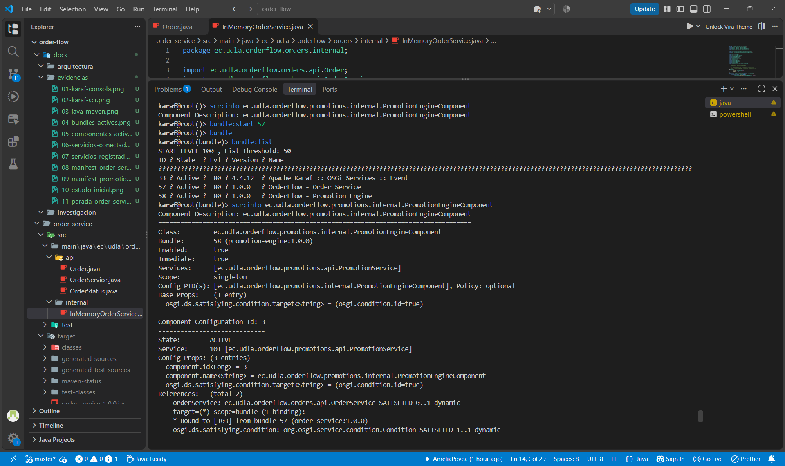

**13. Detención de Promotion Engine**

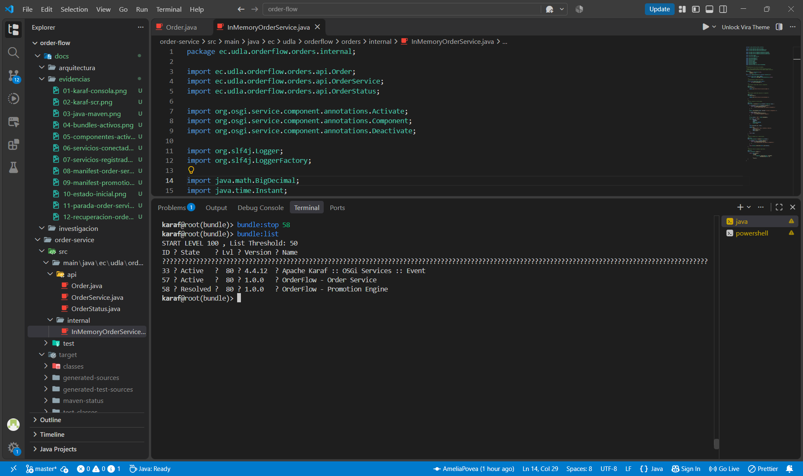

**14. Recuperación de Promotion Engine**

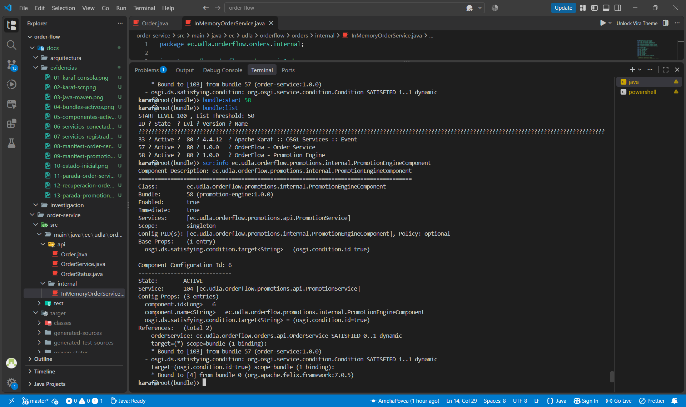

### 10.5. Construcción y verificación

**15. Resultado de la construcción Maven**


En esta evidencia mostramos el resultado de la construcción del proyecto y verificamos que los módulos puedan compilarse y empaquetarse correctamente.

---

## 11. ¿Por qué elegimos esta arquitectura?

Elegimos OSGi porque el objetivo principal del deber no era simplemente desarrollar una aplicación de pedidos, sino comprender cómo podemos construir un sistema modular en el que sus componentes tengan responsabilidades independientes.

Consideramos que la separación entre pedidos y promociones representa un buen ejemplo para demostrar esta característica.

Si hubiéramos implementado todo dentro de un único módulo, sería más difícil demostrar la independencia entre componentes. Por eso decidimos separar las responsabilidades y utilizar interfaces públicas para establecer la comunicación.

También elegimos Apache Karaf porque proporciona herramientas para administrar los bundles durante la ejecución, consultar sus estados y comprobar las referencias entre servicios.

Otra decisión importante fue utilizar referencias dinámicas y opcionales. Esto nos permitió comprobar que Promotion Engine puede mantenerse activo cuando Order Service se detiene y que la conexión puede recuperarse cuando el servicio vuelve a estar disponible.

De esta manera conseguimos representar una arquitectura modular que puede ampliarse incorporando nuevos bundles sin tener que modificar necesariamente la implementación interna de los módulos existentes.

---

## 12. Limitaciones y posibles mejoras

Aunque nuestra implementación cumple con el propósito académico del ejercicio, reconocemos que todavía existen aspectos que podríamos mejorar para acercarla a un sistema empresarial.

Entre las posibles mejoras tenemos:

- Incorporar una base de datos para almacenar los pedidos de manera permanente.
- Implementar una API para permitir que otros sistemas puedan registrar y consultar pedidos.
- Agregar nuevas reglas de promociones, como descuentos por cantidad o promociones especiales.
- Incorporar pruebas automatizadas para verificar las operaciones de pedidos y promociones.
- Implementar mecanismos de registro y monitoreo para facilitar el diagnóstico de errores.
- Agregar nuevos bundles, como inventario, facturación y notificaciones.

Actualmente utilizamos una implementación en memoria, por lo que los datos no tienen persistencia después de reiniciar el entorno.

También debemos considerar que detener un bundle no significa que las operaciones que dependen de él puedan continuar normalmente. Por ejemplo, mientras Order Service está detenido, Promotion Engine puede permanecer activo, pero no puede realizar las operaciones que necesitan el servicio de pedidos.

---

## 13. Conclusiones

Durante el desarrollo de OrderFlow comprendimos que OSGi permite construir aplicaciones Java de una manera diferente a la estructura tradicional de un único programa.

Aprendimos a dividir una aplicación en bundles, definir interfaces públicas, publicar servicios y permitir que otros componentes los consuman sin depender directamente de sus implementaciones.

Uno de los aspectos más importantes fue comprobar el funcionamiento del ciclo de vida de los bundles mediante Apache Karaf. Pudimos detener Order Service y observar que Promotion Engine permanecía activo, además de comprobar que la referencia al servicio desaparecía y volvía a establecerse cuando iniciábamos nuevamente el módulo.

También comprendimos la importancia de utilizar referencias dinámicas y opcionales para construir componentes que puedan adaptarse a la disponibilidad de otros servicios.

Finalmente, consideramos que este ejercicio nos permitió entender cómo una aplicación pequeña puede organizarse utilizando principios que también son importantes en sistemas empresariales más grandes. Aunque nuestro proyecto es sencillo, la separación de responsabilidades, el bajo acoplamiento y la administración independiente de componentes son características que podemos aplicar en desarrollos de mayor complejidad.

**Con OrderFlow conseguimos implementar y comprobar una arquitectura modular basada en OSGi, utilizando Apache Karaf como entorno de ejecución y dos bundles relacionados mediante servicios, cumpliendo el propósito principal del ejercicio.**
